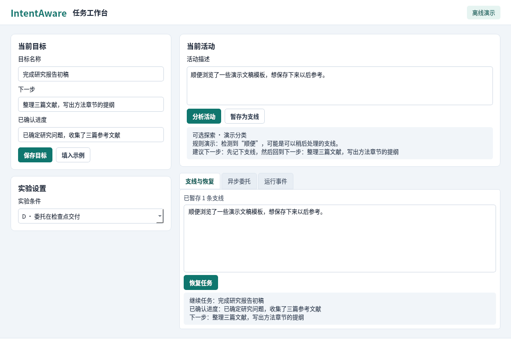

Language / 语言：[简体中文](README.md) | **English**

# IntentAware-Agent

**HKU COMP7607 · Natural Language Processing · Group 14**

## Quick start

Python 3.11 or newer is required. Run these commands from the repository root.

**Windows (PowerShell)**

```powershell
py -3 -m venv .venv
.\.venv\Scripts\python -m pip install -e ".[dev]"
.\.venv\Scripts\python -m intentaware --demo
```

After installing Python, you can also double-click [start.bat](start.bat). The first launch downloads dependencies. Later launches can run offline.

**macOS / Linux**

```bash
python3 -m venv .venv
.venv/bin/python -m pip install -e ".[dev]"
.venv/bin/python -m intentaware --demo
```

The app opens in condition D by default. Load the sample inputs in the window, save the goal, then classify an activity or submit a delegation request. [Six-step demo, module ownership, and tests (Chinese)](docs/GETTING_STARTED.md)

### What runs today

- A Chinese-language PySide6 desktop app that uses offline rules to classify user-supplied context into four activity categories and show a reason and suggested next step.
- SQLite storage for the current goal, confirmed progress, and detours. Those records are available after restarting the app.
- G/P/I/D feature gates, background delegation with immediate or deferred delivery, early viewing, cancellation, and JSONL export for the current run. Delegation jobs live for the current app session.
- Classification and delegation use offline demo providers and require no runtime network access or API keys. LLM integration and live retrieval are follow-up work. This starter supports workflow checks and event collection for the planned evaluation.

### Desktop preview



## Overview

**IntentAware-Agent** is a desktop AI task companion for studying, writing, and coding. It interprets side activities in the context of a user's primary goal, captures useful detours and progress, and helps users resume work after interruptions. Users can delegate non-urgent questions to a background agent and choose when to view the results.

### Typical workflow

1. **Set a goal:** Enter the current task and next action, such as “Finish the Related Work section of my paper.”
2. **Provide context:** Describe the current activity, ask a side question, or paste text for analysis.
3. **Interpret activity:** The agent classifies it as direct progress, necessary preparation, optional exploration, or unclear, with an explanation.
4. **Capture or delegate:** Save detours or send a side question to the background agent.
5. **Resume work:** Get an actionable next step based on confirmed progress; view delegated answers immediately or at a task checkpoint.

## Module goals

| Module | Responsibilities |
| --- | --- |
| **Goal & Intent** | Clarify the main goal and next step; classify activities in context with explanations |
| **Detour & Resume** | Store links, notes, and confirmed progress; suggest concrete resumption actions |
| **Async Delegation** | Turn questions into editable requests; retrieve up to two public sources and draft cited answers |
| **Deferred Delivery** | Control when results appear; support checkpoints, early viewing, and cancellation |
| **Experiment & Evaluation** | Log task events, switch study conditions, and evaluate classification and task continuity |

## Tech stack

| Component | Technology |
| --- | --- |
| Desktop GUI | **Python + PySide6** |
| NLP inference | Offline classifier with an interface for an LLM adapter |
| Local persistence | SQLite |
| Background processing | Python worker / thread |
| Experiment analysis (planned) | pandas + scikit-learn |
| Automated tests | pytest |

The application uses modular Python components. Users provide the context they want analyzed, while task state is stored locally. The UI runs classification and delegation in the background and applies their results on the main thread.

## Research and evaluation

Four feature conditions are compared:

| Condition | Capabilities |
| --- | --- |
| **G** | Goal-aware reminders |
| **P** | G + detour capture and task resumption |
| **I** | P + asynchronous delegation, with results shown when ready |
| **D** | P + asynchronous delegation, with checkpoint-based delivery (early viewing allowed) |

The evaluation plan includes a pilot, a within-participant study with **12–18 adults**, **60 task-context examples**, and **40 held-out delegation requests**.

Key measures include macro-F1 and false-warning rates for activity classification, task completion and output quality, resumption time, source support, perceived burden, latency, and token usage. Resumption time ends at the next observable meaningful main-task edit.

## Four-week development plan

| Week | Main deliverables |
| --- | --- |
| **1** | Project foundation, PySide6 UI, shared schemas, SQLite and LLM adapters; begin study preparation |
| **2** | End-to-end Goal & Intent and Detour & Resume flow |
| **3** | Async Delegation, Deferred Delivery, study-condition switches, and integration tests |
| **4** | Pilot and evaluation, analysis, demo, and final report |

## Project layout

```text
src/intentaware/
├── ui/             # Desktop interface
├── nlp/            # Goal understanding and activity classification
├── memory/         # Progress, detours, and resumption
├── delegation/     # Offline delegation provider
├── contracts/      # Shared schemas and interfaces
├── session.py      # Feature gates, background work, and delivery
└── __main__.py     # Command-line entry point

experiments/        # Study tasks, logs, and analysis
tests/              # Automated tests
docs/               # Technical documentation and workstream guides
TODO.md             # Development checklist
CONTRIBUTING.md     # Team workflow
```

## Team collaboration

Team members can claim an entire workstream or specific subtasks through GitHub Issues:

**[A Desktop UI](https://github.com/Ir1svanquish/IntentAware-Agent/issues/1)** · **[B NLP](https://github.com/Ir1svanquish/IntentAware-Agent/issues/2)** · **[C Task Memory](https://github.com/Ir1svanquish/IntentAware-Agent/issues/3)** · **[D Delegation](https://github.com/Ir1svanquish/IntentAware-Agent/issues/4)** · **[E Evaluation](https://github.com/Ir1svanquish/IntentAware-Agent/issues/5)** · **[F Contracts & Integration](https://github.com/Ir1svanquish/IntentAware-Agent/issues/6)**

[All open tasks](https://github.com/Ir1svanquish/IntentAware-Agent/issues) · [Claiming & acceptance guide](docs/WORKSTREAMS.md) · [Development TODO](TODO.en.md) · [Contributing guide](CONTRIBUTING.en.md)


### Join the development team

Group members can comment with their GitHub handle and preferred module in [Join Request Issue #7](https://github.com/Ir1svanquish/IntentAware-Agent/issues/7). Maintainers can invite verified teammates; contributors may also fork and open Pull Requests.

## Data and privacy

The app uses context supplied by the user and stores data in local SQLite. Keep identifiable personal data out of study records. When adding a model provider, read API keys from local environment variables.
